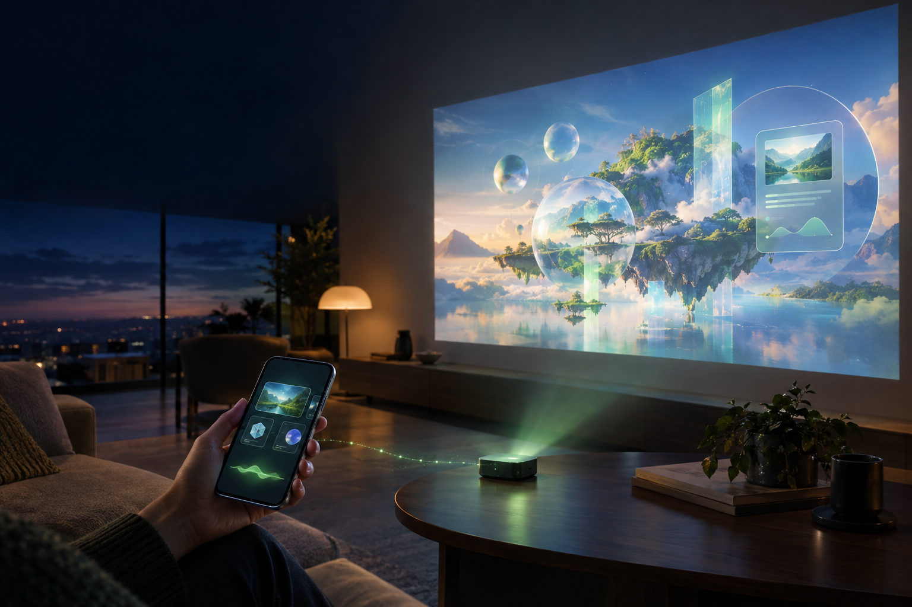
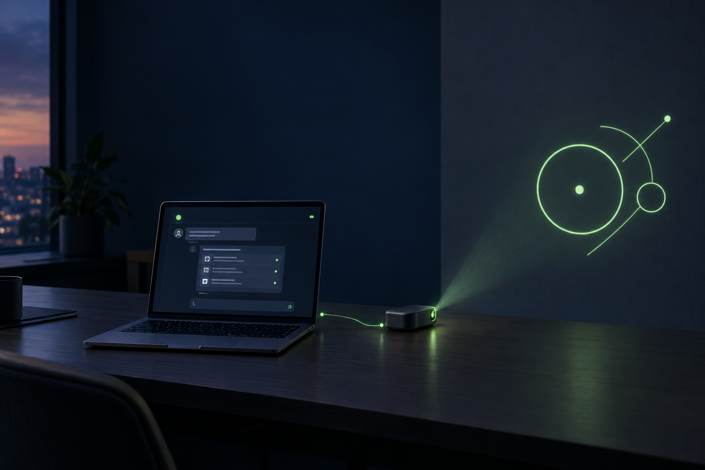
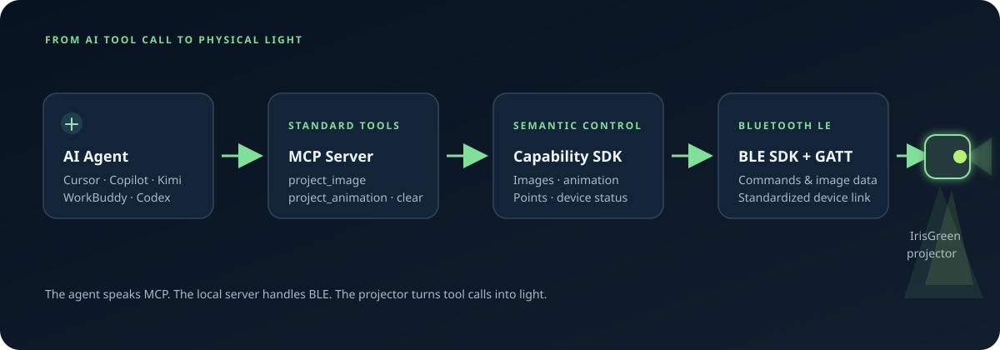

# IrisGreen — The Physical Display Interface for AI Phones

**Give AI a display beyond the screen.**



*AI Phone physical-display vision — a concept illustration, not a product photograph or a claim of native phone integration.*

[**Buy IrisGreen**](https://irisarworld.com/irisgreen/?utm_source=github&utm_medium=readme&utm_campaign=irisgreen-ai-physical-interface)

AI phones are becoming more capable at creating and understanding visual content, but their output is still trapped on a small screen. **Our vision is for IrisGreen to become the physical display interface for AI phones**—so an AI can bring images, animations, and shared visual experiences into the room around you.

That direct phone-to-projector experience is the vision, not a shipping integration today. The working foundation is already here: AI agents on supported desktop and work clients call IrisGreen through **MCP**, and a local Bluetooth LE connection turns those calls into projected light. Camera vision and object tracking are not part of the current release.

---

## Let your AI agent put light on a wall

IrisGreen speaks **MCP (Model Context Protocol)**, so compatible coding and work agents can use the same device tools without custom BLE code.

| Agent | Status |
|---|---|
| **Cursor** | Verified: an agent projected through MCP tools on a real projector |
| **VS Code Copilot** (agent mode) | Verified: an agent projected through MCP tools on a real projector |
| **WorkBuddy** | Verified on hardware; config included ([.mcp.json](.mcp.json)) |
| **Kimi Work** | Verified on hardware |
| **Codex** | Verified by the user; standard stdio MCP configuration documented |

### Give it a physical task

| Ask your agent to… | It can… |
|---|---|
| “Project this picture.” | Connect and show a full-field image |
| “Loop these frames as an animation.” | Upload and play 1–10 frames from group 1 |
| “Put a dot near the center.” | Project a point in the 640×480 projector field |
| “Turn the projector light off.” | Clear the projection and report device status |

Eight MCP tools cover connect/disconnect, image and animation projection, point projection, clear, and status. The server returns structured results so the agent can tell whether a tool call succeeded.

**Verification note:** single-image projection has been confirmed with real agent clients on hardware. `project_animation` currently passes simulator tests; it has not yet been verified on a real projector, and the 10-frame group-1 limit still needs hardware confirmation.

### Try it

Install the Python dependencies, then run the built-in simulator—no projector needed:

```text
python -m pip install -r requirements.txt
python mcp/irisgreen-mcp-server/launch.py --simulate   # try it with no hardware
```

For real hardware, connect over Bluetooth (the host must have a BLE adapter and OS permission):

```text
python mcp/irisgreen-mcp-server/launch.py --address <BLE address>
```

Setup for each client, including Codex (`~/.codex/config.toml`), is in the [MCP server guide](mcp/irisgreen-mcp-server/README.md#client-configuration).



*Current MCP workflow concept, not a photograph of the IrisGreen product.*

---

## 1. Project Vision

Traditional AI interfaces primarily operate in digital environments:

- Text and chat interfaces
- APIs and software tools
- Computer Use and GUI automation

IrisGreen extends AI interaction into the physical world.

An AI Agent should be able to:

1. Understand the physical interaction task.
2. Generate or select an appropriate algorithm.
3. Convert the task into standardized hardware capabilities.
4. Execute commands through the IrisGreen device.
5. Observe execution results and adjust its behavior.

**Core principle:**

Separate hardware communication, physical capabilities, algorithms, and AI orchestration.

The hardware interface should remain stable while AI-generated algorithms and applications evolve independently.

---

## 2. System Architecture

The system is divided into five logical layers.



### Layer 1 — IrisGreen GATT Profile

Defines the standardized BLE communication contract between IrisGreen hardware and external clients.

Responsibilities:

- GATT Service and Characteristic definitions
- UUID specifications
- Read / Write / Notify properties
- Command and response formats
- Data packet definitions
- Error codes and device status
- Protocol versioning

This layer defines WHAT the device exposes, not HOW different platforms implement BLE communication.

The GATT specification should remain platform-independent.

### Layer 2 — BLE Protocol SDK

Provides cross-platform BLE communication and protocol implementation.

Responsibilities:

- BLE device discovery
- Connection and disconnection
- GATT service discovery
- Characteristic read / write / notify
- Packet fragmentation and reassembly
- Data transmission and retransmission
- Connection state management
- Protocol serialization and deserialization

Target platforms:

- Android
- iOS
- Windows / Linux PC

Reference implementations:

- Python + Bleak: existing PC implementation and protocol reference.
- Flutter: cross-platform mobile implementation for Android and iOS.

The goal is to implement the same IrisGreen GATT protocol across platforms without changing device firmware.

### Layer 3 — Capability SDK

Provides high-level physical device capabilities.

AI applications should not need to understand BLE characteristics or packet formats.

Instead, they interact with semantic APIs.

Initial capabilities:

**Projection**
- `project.point(x, y)` — show a dot in projector pixels.
- `project.image(image)` — project a single full-field image.
- `project.animation(frames)` — store and loop 1–10 frames in group 1.
- `project.clear()` and `project.status()` — control and inspect projection.

**Device Control**
- device.connect()
- device.disconnect()
- device.get_status()

Camera, calibration and tracking capabilities were removed for now; see [ADR 0001](docs/adr/0001-remove-camera-pipeline.md).

The Capability SDK translates high-level operations into BLE Protocol SDK commands.

### Layer 4 — MCP Server / Agent Tools

Exposes IrisGreen capabilities to AI Agents through standardized tool interfaces.

Responsibilities:

- Expose device capabilities as AI-callable tools.
- Translate Agent tool calls into Capability SDK operations.
- Manage task execution and command sequencing.
- Return device status and execution results.
- Support AI-generated algorithms and dynamic task orchestration.

For example, an agent can take “show these frames as a looping animation” and call `device_connect`, `project_animation`, and `project_status`. The tool validates the request, prepares each image, uploads the frames, and starts playback.

**Important:** MCP is the Agent-facing interface, not the BLE communication implementation.

The MCP execution environment must have access to the local BLE-capable device runtime. MCP does not independently bypass iOS or Android BLE permissions.

### Layer 5 — AI Algorithms / Applications (future)

Future perception and interaction algorithms can be independent, pluggable components. They are not included in the current MCP release.

They should not be tightly coupled to BLE or GATT.

Potential algorithms:

- Object detection
- Object tracking
- Visual segmentation
- Camera calibration
- Camera-to-projector coordinate mapping
- Motion prediction
- Spatial interaction

Algorithm implementations can come from:

- AI Agent generated code
- Existing open-source algorithms
- User-provided implementations
- Optimized native implementations

The Agent chooses and orchestrates algorithms according to the task.

The Capability SDK provides the stable execution interface.

---

## 3. Core Design Principles

### 3.1 Hardware / Software Decoupling

The GATT Profile defines the communication contract.

The BLE Protocol SDK implements communication.

The Capability SDK abstracts physical operations.

AI Agents operate on capabilities rather than hardware details.

### 3.2 Algorithm Independence

Algorithms must not be embedded into the BLE communication layer.

Tracking, detection, segmentation, and spatial mapping should be independently replaceable.

### 3.3 AI-Native Architecture

The system should be designed for AI Agent interaction from the beginning.

Capabilities should have:

- Clear semantic names
- Explicit input and output schemas
- Structured error handling
- Observable execution states
- Machine-readable documentation

### 3.4 Cross-Platform Support

The same hardware protocol and capability definitions should work across Android, iOS, and PC.

Platform-specific BLE implementations should be isolated behind a common interface.

### 3.5 Hardware Safety

Physical safety constraints must be enforced by firmware or another trusted execution layer.

Examples:

- Laser power limits
- Mechanical operating limits
- Emergency stop
- Device-side command validation

AI-generated algorithms must never bypass hardware safety constraints.

---

## 4. Initial Development Scope

### Phase 1 — Protocol Foundation

- Document IrisGreen GATT Profile.
- Extract and standardize existing Python + Bleak implementation.
- Define protocol data structures.
- Validate connection, read, write, and notification operations.

### Phase 2 — Cross-Platform BLE

- Build Flutter BLE POC.
- Implement Android BLE communication.
- Implement iOS BLE communication.
- Reproduce the existing PC communication workflow.
- Validate the same GATT protocol across platforms.

### Phase 3 — Capability SDK

- Implement device connection capabilities.
- Implement projection capabilities.
- Implement image / 1bpp transmission.
- Implement device status and error reporting.
- Define calibration and coordinate mapping interfaces.

### Phase 4 — MCP Integration

- Expose Capability SDK operations as MCP tools.
- Implement Agent-callable device operations.
- Support structured inputs and outputs.
- Validate AI Agent to physical device execution.

### Phase 5 — AI Physical Applications

- Integrate object tracking.
- Integrate visual perception.
- Support AI-generated algorithm implementations.
- Build end-to-end physical interaction applications.

---

## 5. Non-Goals

The initial refactoring is NOT intended to:

- Redesign the existing hardware firmware.
- Replace the existing GATT communication protocol without necessity.
- Couple tracking algorithms to BLE communication.
- Implement a monolithic AI Agent inside the device.
- Require every algorithm to be implemented in Flutter.
- Make MCP responsible for low-level BLE communication.

The priority is to establish stable interfaces and independent software layers.

---

## 6. Long-Term Vision

IrisGreen is not simply a laser projection device.

It is a physical interaction interface that allows AI Agents to connect digital intelligence with real-world actions.

The long-term architecture should support new hardware, new sensors, new algorithms, and new AI Agents without redesigning the entire system.

**Stable hardware interfaces.  
Composable physical capabilities.  
Replaceable intelligence.  
AI-native physical interaction.**

---

## 7. Roadmap and Status

| Version | Goal | Acceptance | Status |
|---|---|---|---|
| V0.1 | IrisGreen GATT Profile | PC, Android and iOS can connect | Specified and implemented ([docs](docs/gatt-profile.md)). **Verified on PC** with a real IrisGreen; Android and iOS not yet verified |
| V0.2 | BLE Protocol SDK | Images and commands transfer across platforms | Python and Flutter SDKs agree on shared golden vectors. **Verified on PC**: commands, and 50 of 50 image uploads on a real device; Android and iOS not yet verified |
| V0.3 | Capability SDK | Unified projection and status interfaces | Implemented ([spec](docs/capability-spec.md)), tested against the simulator. No camera ([ADR 0001](docs/adr/0001-remove-camera-pipeline.md)) |
| V0.4 | MCP Server | An AI Agent can call the device | Implemented, 8 tools, tested over in-memory and stdio MCP. A scripted MCP client projected an image on a real device (`project_animation` is simulator-only so far) |
| V0.5 | Reference Algorithms | Reference tracking, calibration and mapping | Removed with the camera pipeline; recoverable from branch `archive/camera-pipeline` |
| V1.0 | AI Physical Interface | An AI Agent completes a vision-to-physical-projection task on its own | Deferred until a camera is reintroduced |

Everything above the BLE layer is verified against a simulator that speaks the real protocol. Verification on real hardware is the remaining acceptance work, tracked in the [hardware verification to-do list](docs/hardware-verification.md).

## 8. Repository Layout

```text
docs/                         architecture, GATT profile, protocol and capability specs, ADRs
protocol/
  gatt/specification/         machine-readable GATT profile (V0.1)
  python/bleak/               PC transport (Python + Bleak) and hardware check scripts
  flutter/ble/                Android and iOS SDK and transport (Dart)
sdk/
  ble-protocol-sdk/           commands, image packing, IrisClient (V0.2)
  capability-sdk/             capabilities, runtime, rendering, simulator (V0.3)
mcp/irisgreen-mcp-server/     MCP server (V0.4)
examples/                     basic-projection, image-projection
tests/                        protocol, cross-platform, capability, mcp
```

## 9. Quick Start

Need the hardware? [Buy IrisGreen](https://irisarworld.com/irisgreen/?utm_source=github&utm_medium=readme&utm_campaign=irisgreen-ai-physical-interface). Everything below also runs without it, against the built-in simulator.

```text
pip install -r requirements.txt
python -m pytest                                      # Python tests (simulated hardware)
cd protocol/flutter/ble && flutter test               # Dart tests

python examples/image-projection/main.py --simulate   # project pictures, no hardware
python examples/basic-projection/main.py --address <BLE address>
```

To let an agent drive the device, see [mcp/irisgreen-mcp-server](mcp/irisgreen-mcp-server/README.md).
