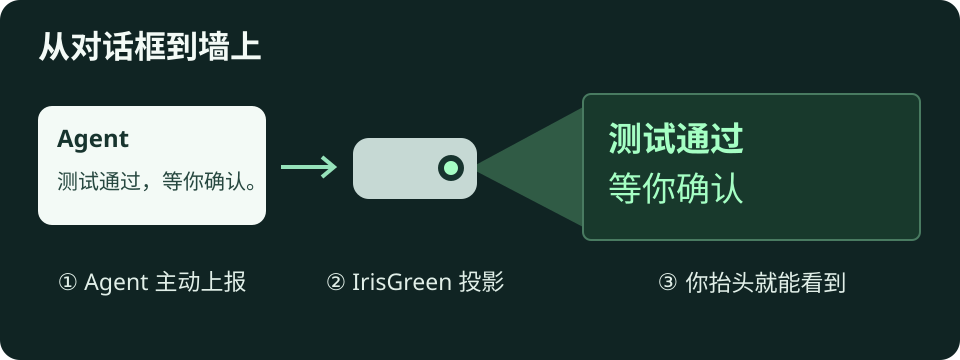

# IrisGreen Agent Signal

**不必盯着聊天窗口。Agent 需要你时，抬头就能看见。**

**[购买 IrisGreen 投影器 →](https://irisarworld.com/irisgreen/?utm_source=github&utm_medium=readme&utm_campaign=irisgreen-agent-signal)** · [没有设备？先试模拟器](#今天可以试什么)



一次真机测试里，Agent 在墙上投了一句话：「你不用盯着屏幕。有重要发现，我会告诉你。」对面的人回了一句：「嗯我看到了。」

这就是 IrisGreen Agent Signal 要做的事：给你和 Agent 之间留一个不用守在屏幕前的联络方式。日常工作安静进行；遇到关键发现、需要你决定、或终于完成时，Agent 可以把一句值得你抬头的话投出来。细节和回复仍留在你原来的对话里。

## 什么值得投到墙上？

| 时刻 | 你可能看到 |
|---|---|
| 你想知道是谁在工作 | **Copilot · INTP**（Agent 自选的交互风格） |
| 有进展，但不需要打断你 | **正在测试** · 已完成协议校验，正在检查设备连接 |
| 下一步只有你能决定 | **等你确认** · 是否将这次改动发布到主分支？ |
| 可以回来收结果了 | **投影测试完成** · 设备已清屏，可以断开 |

Agent 通过 **IGASP**（IrisGreen Agent Status Protocol）主动报告身份、状态、任务或消息；它说的是「我想告诉你什么」，而不是「把激光移到哪里」。IrisGreen 不窥探内部推理，不猜人格，也不编造进度。墙上出现批准请求，不代表你已经批准。

## 今天可以试什么？

**已经在墙上看到的：** Agent 主动上报的一条中文消息，经本地接收器排成 640×480 状态卡，传到真实的 IrisGreen 投影器，由现场用户确认看见。一次消息投递不等于所有客户端和连续状态切换都已验收。

**从公开仓库开始：** 没有投影器也可以先用模拟设备验证图像投递。从仓库根目录运行：

```shell
python -m pip install -r requirements.txt
python examples/image-projection/main.py --simulate
```

这个示例验证的是**设备输出**；它不会连接真实 Agent，也不会出光。要接入设备 MCP，请看[客户端配置与真机操作](mcp/irisgreen-mcp-server/README.md)。要了解从 BLE 到投影的验证边界，请看[硬件验收记录](docs/hardware-verification.md)。

**接入你的 Agent：** 一条命令把上报服务注册到 Cursor、Codex 和 VS Code Copilot，每个客户端各用自己的身份，令牌只存在本机用户目录里：

```shell
python -m agent_status.setup
python -m agent_status.http --preview irisgreen_data/status.png
```

第二条命令启动接收器，默认只生成预览图、不出光。重新加载客户端后，Agent 就能用 `report_expression` 上报；细节见 [IGASP 说明](docs/igasp.md)。

## 一条明确的边界

这个仓库只做 **Agent 与人的物理交互**。音乐可视化、歌词、娱乐播放和通用投影应用不在路线图里。协议、渲染器和设备 SDK 留在这里，是为了让 Agent 的一句重要消息可靠地到达你面前。

[购买 IrisGreen 投影器 →](https://irisarworld.com/irisgreen/?utm_source=github&utm_medium=readme&utm_campaign=irisgreen-agent-signal)
